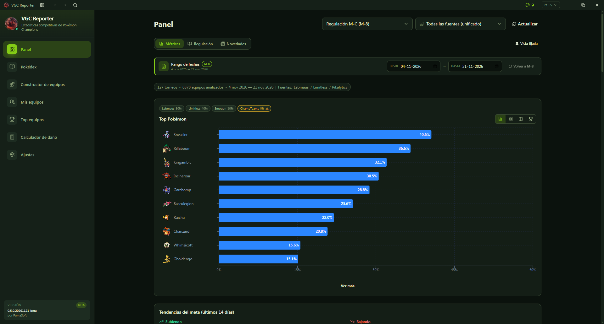
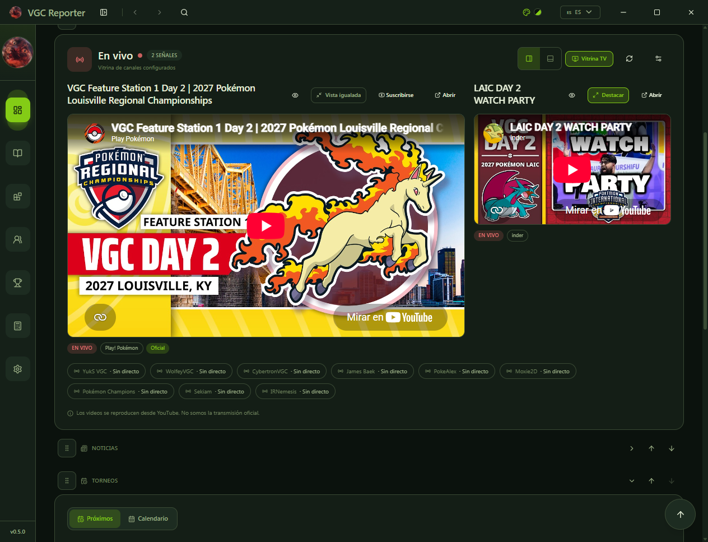
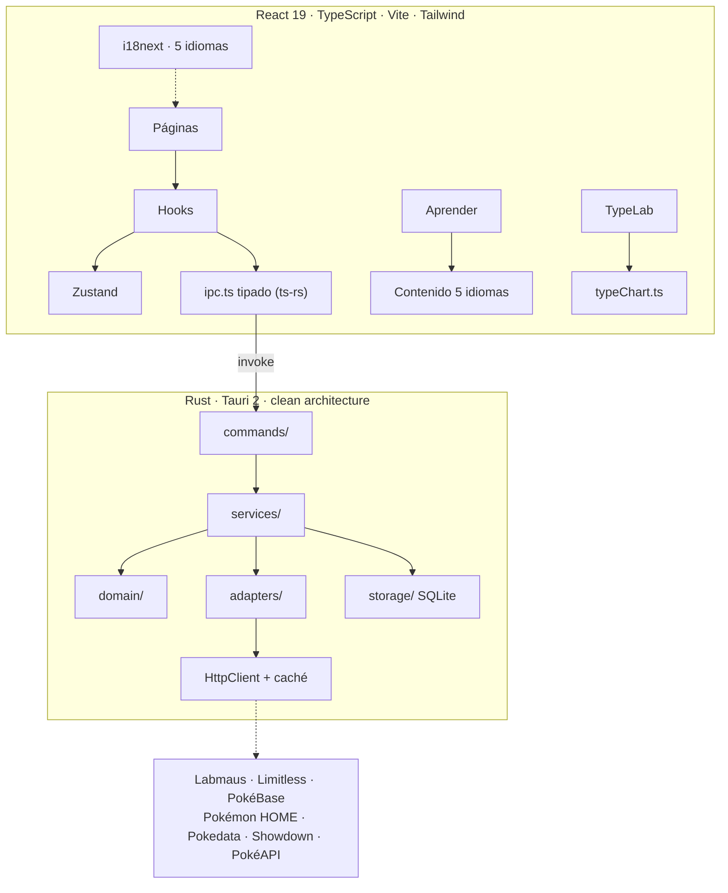
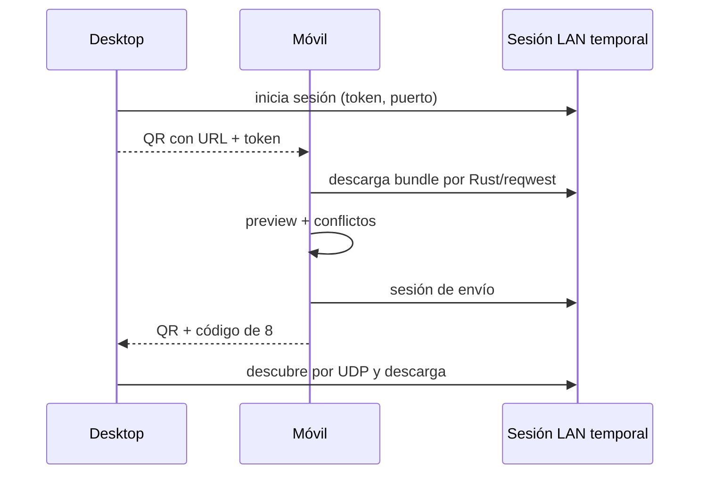

<div align="center">


# VGC Reporter

**Estadísticas competitivas de Pokémon Champions y constructor de equipos, en desktop y Android.**

**Beta pública. Hecha con cariño, datos reales y mucho café. Si algo falla, repórtalo para iterar rápido.**

[![Versión][version-badge]][version-link]
[![Beta][beta-badge]](#descarga)
[![Tauri][tauri-badge]][tauri-link]
[![Rust][rust-badge]][rust-link]
[![React][react-badge]][react-link]
[![Licencia][license-badge]](LICENSE)
[![PumaSoft][pumasoft-badge]][pumasoft-link]

[English](README.en.md) · [Descarga](#descarga) · [Capturas](#capturas) · [Funciones](#funciones) · [Aprender](#aprender) · [Fuentes](#fuentes-de-datos) · [Arquitectura](#arquitectura) · [Desarrollo](#desarrollo)

</div>

---

## El problema

Pokémon Champions llegó el 8 de abril de 2026 y se convirtió en la plataforma oficial de VGC 2026 / Worlds. Los datos están repartidos entre Pikalytics, Pokemon-Zone, Porygon Labs, Champions Lab, Smogon, Limitless, PokéBase y los avisos de Pokémon HOME. Ninguna fuente tiene una API unificada ni una experiencia offline para mirar el meta **y** armar un equipo en el mismo lugar.

VGC Reporter es la herramienta que quería mientras construía equipos para Champions: una ventana, datos reales de torneo, calendario de regulaciones, cobertura de tipos, guías y todo cacheado localmente.

## Qué trae

- **Panel Principal** con tres vistas: **Novedades**, **Métricas** y **Regulación**.
- **Aprender**: guías competitivas, práctica diaria, equipos iniciales, amenazas del meta, glosario y herramientas.
- **Constructor Clásico y Champions**: EVs/IVs o 66 Stat Points con conversión automática al cambiar de modo.
- **Top Equipos** de Labmaus, Limitless y la comunidad de PokéBase.
- **En Vivo** con hasta 9 TVs en la Vitrina, últimas transmisiones y control por stream.
- **Tabla de tipos rápida** con `Ctrl+T`.
- **Sincronización LAN** entre desktop y Android por QR y código.
- **Offline-friendly**: SQLite para caché y equipos, todas las llamadas de red en Rust.

## Capturas

<div align="center">
  
  
  <br/>
  
  
  <br/>
  
  
</div>

## Descarga

Instaladores de **`v0.6.0.20261122-beta`**:

| Plataforma | Instalador | Notas |
|---|---|---|
| Windows 10/11 | `VGC.Reporter_0.6.0_x64_en-US.msi` | MSI sin firma Authenticode; SmartScreen → Más información → Ejecutar de todas formas |
| Android 7+ (arm64) | `VGC.Reporter_v0.6.0.20261122-beta_android.apk` | Sideload: activa “Instalar apps desconocidas” |

**[Descargar desde el último release de GitHub](https://github.com/felipesuarez-dev/VGC-Reporter/releases/latest)**

> **Firma:** esta versión usa la llave de updater nueva de 0.5.0. Si una instalación anterior no ofrece la actualización automática, instala el MSI o APK manualmente. En Android, desinstala la versión previa si la firma no coincide.

En el primer arranque se descargan y cachean Pokédex, movimientos, objetos y habilidades. Después funciona offline hasta que expiren las cachés.

## Inicio rápido

```bash
bun install
bun run tauri:dev
```

## Funciones

| Área | Qué hace |
|---|---|
| **Panel Principal** | Novedades (inicio), Métricas y Regulación. Selector dinámico de regulación/temporada, rango de fechas compartido, drag & drop de paneles en las tres vistas (con subir/bajar como alternativa), colapsables y layouts Separados/Juntos. |
| **Métricas** | Top Pokémon en barras, grid, treemap con sprites y tooltip, o tiers. Top objetos/movimientos/habilidades con los Pokémon que más los usan. Trending, torneos recientes y próximos eventos. |
| **Regulación** | Roster elegible, Megas, objetos permitidos con búsqueda, sprites, descripciones y porcentaje del total de equipos. Procedencia y confianza de cada fuente. |
| **Novedades** | Resumen de temporada, muro de directos, torneos + calendario y noticias oficiales. Los paneles se arrastran, agrupan y colapsan; el layout se recuerda. |
| **En Vivo** | Pantallas de YouTube (YukS, Play! Pokémon, Wolfey, Cybertron, James Baek, PokeAlex, Moxie2D, Pokémon Champions, Sekiam, IRNemesis…). Hasta 9 en Vitrina 3×3, últimas transmisiones reales, botón de detener por stream y ojo para ocultar sin recargar los demás. |
| **Próximos torneos** | Limitless online (incluye la tabla `/tournaments/upcoming`) y eventos presenciales de Play! Pokémon. País/ciudad con búsqueda, favorito, dirección completa, precio, inscripción, mapa y `.ics`. |
| **Noticias** | Avisos oficiales paginados, preview dentro de la app, skeleton/shimmer y “Abrir en el navegador”. |
| **Aprender** | Guías (empezar, equipo, stats, speed control, meta, errores), práctica diaria de tipos/velocidad/lead, starters reales, amenazas del meta con debilidades, glosario y accesos directos. |
| **Tabla de tipos** | `Ctrl+T` o botón en la barra: matriz 18×18, cobertura de 1-2 tipos y cobertura del equipo actual (debilidades 4×, resistencias, inmunidades y ataque). |
| **Top Equipos** | Equipos de torneo de Labmaus/Limitless y equipos de comunidad/torneo de PokéBase. Filtros por rango de fechas, fuente, país, jugador y Pokémon. |
| **Constructor** | Clásico (EVs/IVs) y Champions (66 SP, 32 por stat, IVs 31, nivel 50, cláusulas de especie/objeto). Conversión EV↔SP al cambiar de modo. Import/export Showdown. |
| **Mis equipos** | Persistencia SQLite, renombrar, duplicar, eliminar, importar y exportar varios equipos. |
| **Calculadora** | `@smogon/calc` Gen 9 con buscadores para todos los campos. |
| **Pokédex** | Orden por generación/alfabeto/uso, ficha con sets, stats, tipos, matchups y Pikalytics. |
| **Ajustes** | Regulación/temporada, sync, calendario, reproducción, idioma, tema, tamaño de letra, zona horaria, país, pantallas en vivo y overrides de fuentes. |
| **5 idiomas** | ES / EN / FR / IT / PT en UI, datos localizados y Learn. |

## Aprender

La página **Aprender** no es un muro de texto. Reúne:

- **Progreso** de guías leídas.
- **Equipos iniciales** desde torneos recientes y PokéBase, con “Cargar en constructor”.
- **Práctica diaria**: efectividad de tipos con racha, más quizzes de velocidad/lead.
- **Guías** de construcción, cores, Stat Points, speed control, Megas, lectura del meta y errores comunes.
- **Amenazas del meta** con uso y debilidades.
- **Glosario** buscable.
- **Herramientas**: TypeLab, constructor, calculadora, regulación, Top Equipos y calendario.

## Fuentes de datos

| Fuente | Uso |
|---|---|
| Pokémon HOME / Champions notices | Calendario, temporada, roster oficial y Megas |
| Labmaus | Equipos de torneo, meta y validación de regulación |
| Limitless VGC | Torneos, standings, decklists y próximos online |
| PokéBase | Equipos de torneo y comunidad de Pokémon Champions |
| Pokedata / Play! Pokémon | Eventos presenciales, dirección, contacto y precio |
| Smogon | Fallback de ladder |
| Pokepaste | Pastes de equipos |
| Pikalytics | Breakdown por Pokémon |
| Showdown / PokéAPI | Pokédex, movimientos, objetos, habilidades y traducciones |
| YouTube | Directos VGC |
| pokebase.app | Sprites de Megas inventadas por Champions |

**Sin scraping de APIs prohibidas:** PokéBase se lee de su página pública de equipos, respetando `robots.txt`, con caché de 12 h. Si PokéBase atribuye un equipo a otra fuente, se conserva y muestra esa atribución.

## Arquitectura



Las dependencias apuntan siempre hacia dentro. `domain/` no conoce I/O; todo el HTTP pasa por `adapters/http_client.rs` y su caché SQLite.

## Sincronización



- Misma Wi-Fi; sin nube.
- QR para desktop→móvil; código de 8 para móvil→desktop.
- Equipos + configuración + preferencias de UI.
- Conflictos: renombrar el importado, reemplazar u omitir.
- Si la red bloquea la transferencia, se puede exportar/importar un archivo.

## Desarrollo

```bash
bun install
bun run tauri:dev
bun run --cwd frontend test
cd src-tauri && cargo test
```

Calidad antes de release:

```bash
bun scripts/check-locales.ts
bun scripts/bump-version.ts --check --tag v0.6.0.20261122-beta
cd src-tauri && cargo fmt --check && cargo clippy --all-targets -- -D warnings && cargo test
bun run --cwd frontend build && bun run --cwd frontend test
```

## Stack

| Frontend | Backend | Build |
|---|---|---|
| React 19 | Rust 2021 | Tauri 2 |
| TypeScript | tokio | Vite |
| TailwindCSS | reqwest + rustls | Bun |
| TanStack Query | rusqlite + r2d2 | MSI / APK |
| Zustand | serde / thiserror | GitHub Releases |
| React Router | ts-rs | |
| Recharts | | |
| `@smogon/calc` | | |

## Licencia

MIT. VGC Reporter es un proyecto no oficial y sin fines de lucro. No está afiliado a Nintendo, The Pokémon Company, Game Freak ni Creatures Inc. Pokémon y sus nombres son marcas de sus respectivos dueños. Consulta `DISCLAIMER.txt`.

[version-badge]: https://img.shields.io/badge/version-0.6.0.20261122--beta-8b5cf6
[version-link]: https://github.com/felipesuarez-dev/VGC-Reporter/releases
[beta-badge]: https://img.shields.io/badge/status-beta-f59e0b
[tauri-badge]: https://img.shields.io/badge/Tauri-2-24C8DB
[tauri-link]: https://tauri.app
[rust-badge]: https://img.shields.io/badge/Rust-2021-000000
[rust-link]: https://www.rust-lang.org
[react-badge]: https://img.shields.io/badge/React-19-61DAFB
[react-link]: https://react.dev
[license-badge]: https://img.shields.io/badge/license-MIT-green
[pumasoft-badge]: https://img.shields.io/badge/by-PumaSoft-2b86ff
[pumasoft-link]: https://github.com/felipesuarez-dev
