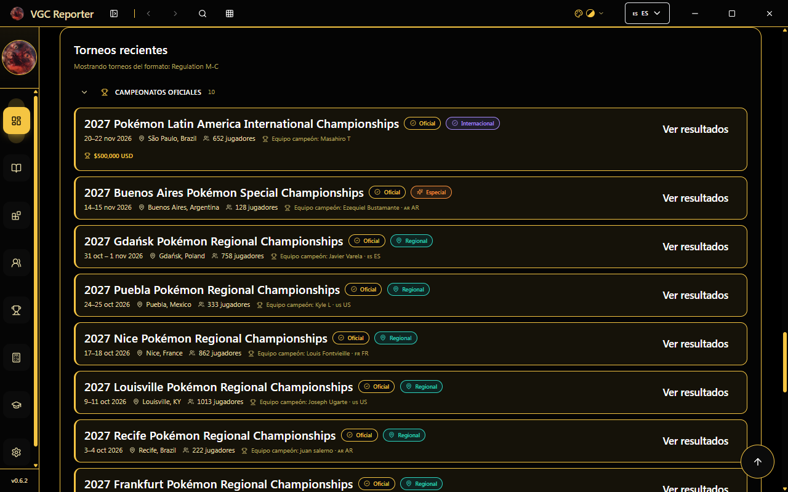
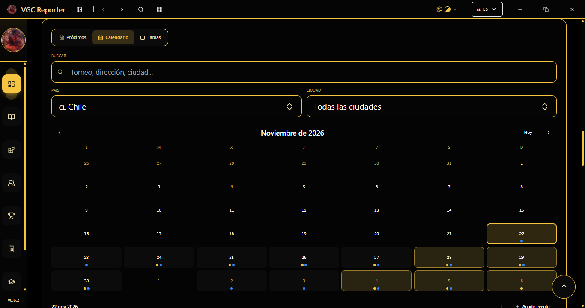
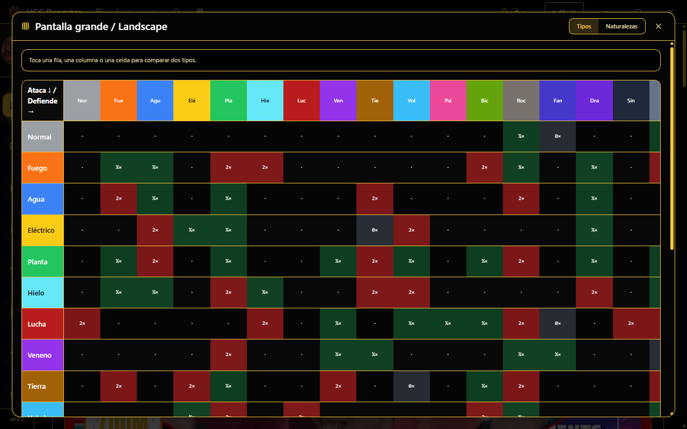
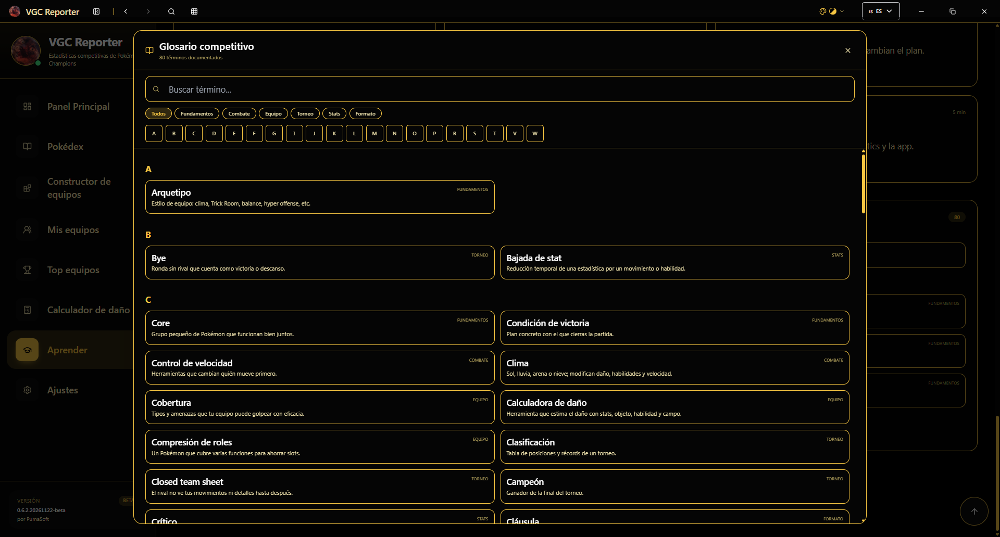
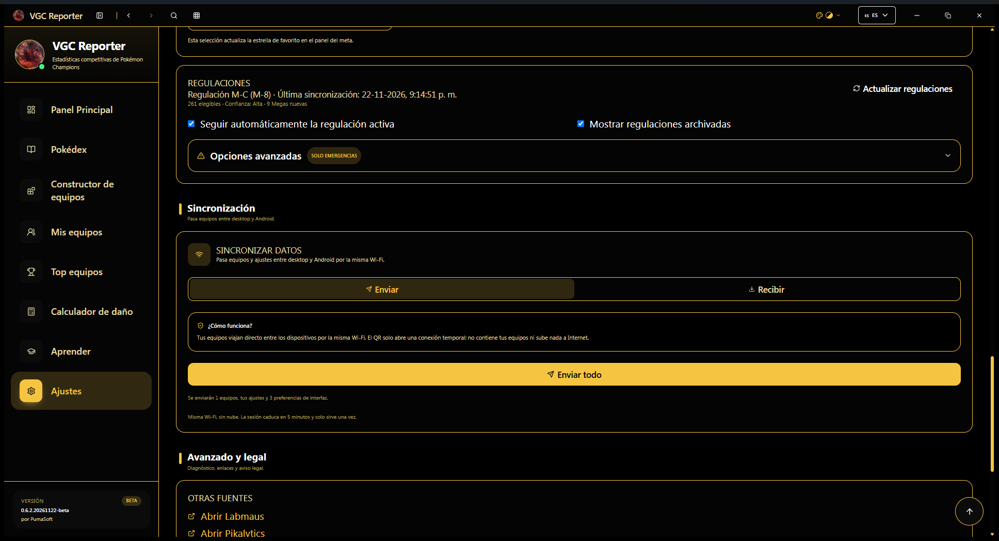
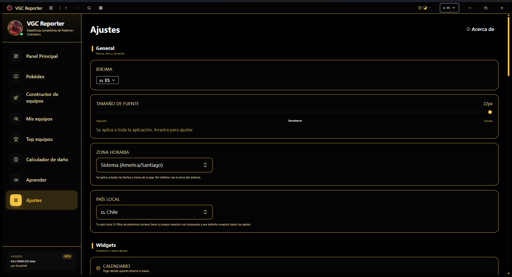
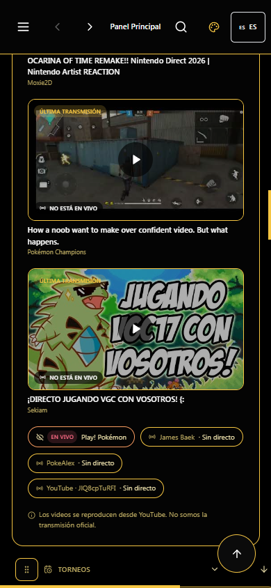
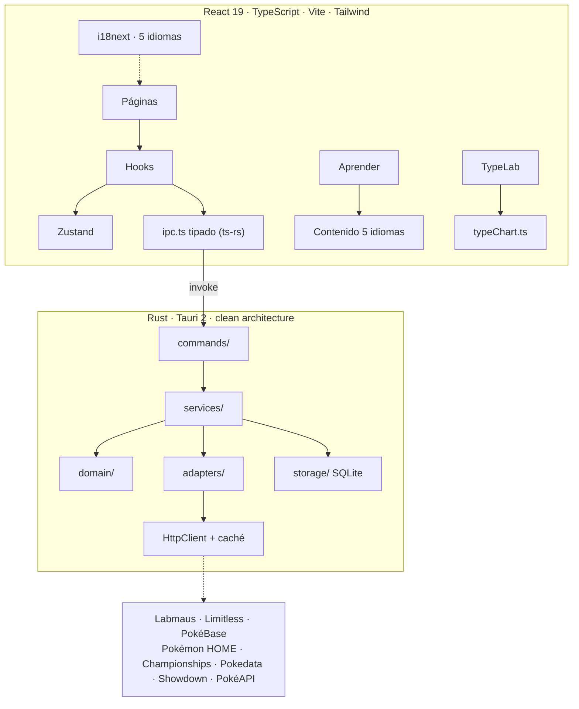
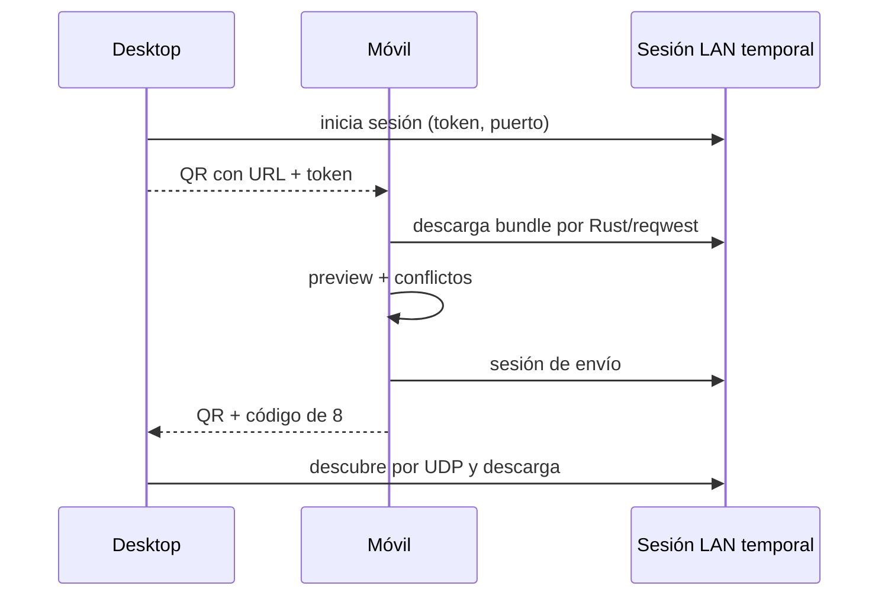

<div align="center">


# VGC Reporter

**Estadísticas competitivas de Pokémon Champions y constructor de equipos, en desktop y Android.**

**Beta pública. Hecha con cariño, datos reales y mucho café. Si algo falla, repórtalo para iterar rápido.**

[![Versión][version-badge]][version-link]
[![Beta][beta-badge]](#descarga)
[![Tauri][tauri-badge]][tauri-link]
[![Rust][rust-badge]][rust-link]
[![React][react-badge]][react-link]
[![Licencia][license-badge]](LICENSE)
[![PumaSoft][pumasoft-badge]][pumasoft-link]

[English](README.en.md) · [Descarga](#descarga) · [Capturas](#capturas) · [Funciones](#funciones) · [Aprender](#aprender) · [Fuentes](#fuentes-de-datos) · [Arquitectura](#arquitectura) · [Desarrollo](#desarrollo)

</div>

---

## El problema

Pokémon Champions llegó el 8 de abril de 2026 y se convirtió en la plataforma oficial de VGC 2026 / Worlds. Los datos están repartidos entre Pikalytics, Pokemon-Zone, Porygon Labs, Champions Lab, Smogon, Limitless, PokéBase y los avisos de Pokémon HOME. Ninguna fuente tiene una API unificada ni una experiencia offline para mirar el meta **y** armar un equipo en el mismo lugar.

VGC Reporter es la herramienta que quería mientras construía equipos para Champions: una ventana, datos reales de torneo, calendario de regulaciones, cobertura de tipos, guías y todo cacheado localmente.

## Qué trae

- **Panel Principal** con tres vistas: **Novedades**, **Métricas** y **Regulación**.
- **Aprender 2.0**: 12 guías, práctica de 10 preguntas/día, trivia, glosario de 80+ términos, 11 arquetipos de cores e insights con muestra y confianza.
- **Constructor Champions y Showdown**: 66 Stat Points o EVs/IVs con conversión automática al cambiar de modo.
- **Top Equipos** de Labmaus, Limitless y la comunidad de PokéBase.
- **En Vivo** con hasta 9 TVs en la Vitrina, últimas transmisiones etiquetadas como no-live y control por stream.
- **Tablas rápidas** de Tipos y Naturalezas con selección, widget panel/flotante y modo landscape.
- **Sincronización LAN** entre desktop y Android por QR/ticket y código, con estados, expiración y cierre tras una transferencia.
- **Updater Android interno** con progreso, cancelación, SHA-256/firma y FileProvider.
- **Torneos oficiales** con modal de resultados/standings, calendario con hoy y agrupación por categoría.
- **Offline-friendly**: SQLite para caché y equipos, todas las llamadas de red en Rust.

## Capturas

<div align="center">
  
  <br/>
  
  
  <br/>
  
  <br/>
  
  
  <br/>
  
  
  <br/>
  
  
  <br/>
  
  
  <br/>
  
  
</div>

## Descarga

Instaladores de **`v0.6.3.20261122-beta`**:

| Plataforma | Instalador | Notas |
|---|---|---|
| Windows 10/11 | `VGC.Reporter_0.6.3_x64_en-US.msi` | MSI sin firma Authenticode; SmartScreen → Más información → Ejecutar de todas formas |
| Android 7+ (arm64) | `VGC.Reporter_v0.6.3.20261122-beta_android.apk` | Sideload o updater interno; activa “Instalar apps desconocidas” |

**[Descargar desde el último release de GitHub](https://github.com/felipesuarez-dev/VGC-Reporter/releases/latest)**

> **Firma:** esta versión usa la llave de updater nueva de 0.5.0. Si una instalación anterior no ofrece la actualización automática, instala el MSI o APK manualmente. En Android, desinstala la versión previa si la firma no coincide.

En el primer arranque se descargan y cachean Pokédex, movimientos, objetos y habilidades. Después funciona offline hasta que expiren las cachés.

## Inicio rápido

```bash
bun install
bun run tauri:dev
```

## Funciones

| Área | Qué hace |
|---|---|
| **Panel Principal** | Novedades (inicio), Métricas y Regulación. Selector dinámico de regulación/temporada, rango de fechas compartido, drag & drop de paneles en las tres vistas (con subir/bajar como alternativa), colapsables y layouts Separados/Juntos. |
| **Métricas** | Top Pokémon en barras, grid, treemap con foreignObject/ellipsis y tooltip, o tiers. Top objetos/movimientos/habilidades con los Pokémon que más los usan y próximos eventos. |
| **Regulación** | Roster elegible, Megas, objetos permitidos con búsqueda, sprites, descripciones y porcentaje del total de equipos. Procedencia y confianza de cada fuente. |
| **Novedades** | Orden por defecto: resumen de temporada → **En vivo** → **Noticias oficiales** → **Torneos recientes** → **Próximos/Calendario/Tablas**. Las **últimas transmisiones** dentro de En vivo también se colapsan. Cada panel carga con su propio skeleton; se arrastran, agrupan y colapsan, y el layout se recuerda. |
| **En Vivo** | Pantallas de YouTube (YukS, Play! Pokémon, Wolfey, Cybertron, James Baek, PokeAlex, Moxie2D, Pokémon Champions, Sekiam, IRNemesis…). Hasta 9 en Vitrina 3×3. Los canales offline muestran su **última transmisión** con badge **No está en vivo**, incluso si están ocultos con el ojo. |
| **Próximos torneos** | Pestañas **Oficiales** (Play! Pokémon presencial + campeonatos de la temporada) y **Comunidad Limitless** (online, no oficiales). Los oficiales incluyen **LAIC, NAIC, EUIC, Regionales, Especiales y Worlds** con badge de nivel, rango de fechas, premio en efectivo, campeón si ya hay resultados y `.ics` multi-día. País/ciudad con búsqueda, favorito, dirección completa, precio, inscripción y mapa; los majors no se ocultan por el filtro local. Los oficiales pasados abren un **modal interno** con standings. |
| **Torneos recientes** | Panel propio en Novedades. Oficiales con modal de resumen, fecha, sede, premio, campeón, standings oficiales y “Lista no publicada”; comunidad con standings/decklists y “Ver clasificación”. |
| **Calendario** | Día actual siempre marcado, dots por categoría, agrupación **Oficiales / Comunidad / Personales**, botón Hoy, filtro de ciudad solo para oficiales locales, multi-día, zona horaria y `.ics`. |
| **Noticias** | Avisos oficiales paginados, preview dentro de la app, skeleton/shimmer y “Abrir en el navegador”. |
| **Aprender** | Progreso, 12 guías, práctica de **10 preguntas/día** (tipos, velocidad, lead, naturaleza, Stat Points, cláusulas), trivia ampliada, **11 arquetipos con “Probar core”**, equipos iniciales, glosario de 80+ términos con índice y 6 insights con muestra/confianza. |
| **Tablas rápidas** | Widget panel (pestaña en Novedades), flotante o card colapsable en Pokédex. Tipos con selección atacante/defensor; naturalezas en grid × stats con +10%/−10%; modo **Pantalla grande / Landscape**. |
| **Top Equipos** | Equipos de torneo de Labmaus/Limitless y equipos de comunidad/torneo de PokéBase. Filtros por rango de fechas, fuente, país, jugador y Pokémon. |
| **Constructor** | **Champions** (66 SP, 32 por stat, IVs 31, nivel 50, cláusulas) y **Showdown** (EVs/IVs). Conversión EV↔SP al cambiar de modo. Import/export Showdown. El modo clásico se conserva internamente para equipos antiguos. |
| **Sincronización** | QR versionado + código de 8, sesión de 5 minutos, token obligatorio, un solo uso, estados visibles, preview “Enviar todo”, conflictos renombrar/reemplazar/omitir y fallback manual. |
| **Updater** | Desktop con diagnóstico y fallback MSI. Android descarga interna con progreso/cancelación, verificación de tamaño/SHA-256/firma y FileProvider; “Abrir en GitHub” queda como opción secundaria. |
| **Móvil** | Navbar con atrás/adelante, menús de tema/idioma compartidos con estrella, `100dvh` + safe-area en landscape y tablas táctiles. |
| **Mis equipos** | Persistencia SQLite, renombrar, duplicar, eliminar, importar y exportar varios equipos. |
| **Calculadora** | `@smogon/calc` Gen 9 con buscadores para todos los campos. |
| **Pokédex** | Orden por generación/alfabeto/uso, ficha con sets, stats, tipos, matchups y Pikalytics. |
| **Ajustes** | Secciones General, Widgets, Reproducción y directos, Datos y fuentes, Sincronización y Avanzado. Calendario y tablas rápidas como widgets; pantallas en vivo como lista editable; sync QR-first. |
| **5 idiomas** | ES / EN / FR / IT / PT en UI, datos localizados y Learn. |

## Aprender

La página **Aprender** no es un muro de texto. Reúne:

- **Progreso** visual de guías leídas.
- **Equipos iniciales** desde torneos recientes y PokéBase, con “Ver más” y “Cargar en constructor”.
- **Práctica diaria**: **10 preguntas** de tipos, velocidad, leads, naturalezas, Stat Points y cláusulas, con explicación obligatoria, puntaje y racha.
- **Trivia de reglas** diaria con explicación.
- **Cores reales del meta** y **11 arquetipos** con roles, condición de victoria, cómo se juega, variantes y **Probar core** desde datos del meta actual.
- **Datos que importan**: mejor win rate con muestra, mejor top cut, amenaza emergente, respuesta anti-meta, speed control y objeto clave, con muestra/fuentes/confianza.
- **12 guías** de 6 secciones con ejemplos, errores, checklist y ejercicio.
- **Glosario** de 80+ términos, 6 categorías, buscador, chips e índice alfabético en modal.
- **Herramientas**: tablas rápidas, constructor, calculadora, regulación, Top Equipos y calendario.

## Fuentes de datos

| Fuente | Uso |
|---|---|
| Pokémon HOME / Champions notices | Calendario, temporada, roster oficial y Megas |
| Labmaus | Equipos de torneo, meta y validación de regulación |
| Limitless VGC | Torneos, standings, decklists y próximos online |
| PokéBase | Equipos de torneo y comunidad de Pokémon Champions |
| Calendario oficial Championship Series | LAIC, NAIC, EUIC, Regionales, Especiales y Worlds; fechas, sede, premios y resultados |
| Pokedata / Play! Pokémon | Eventos presenciales, dirección, contacto y precio |
| Smogon | Fallback de ladder |
| Pokepaste | Pastes de equipos |
| Pikalytics | Breakdown por Pokémon |
| Showdown / PokéAPI | Pokédex, movimientos, objetos, habilidades y traducciones |
| YouTube | Directos VGC |
| pokebase.app | Sprites de Megas inventadas por Champions |

**Sin scraping de APIs prohibidas:** PokéBase se lee de su página pública de equipos, respetando `robots.txt`, con caché de 12 h. Si PokéBase atribuye un equipo a otra fuente, se conserva y muestra esa atribución.

## Arquitectura



Las dependencias apuntan siempre hacia dentro. `domain/` no conoce I/O; todo el HTTP pasa por `adapters/http_client.rs` y su caché SQLite.

## Sincronización



- Misma Wi-Fi; sin nube.
- QR para ambos sentidos; código de 8 para desktop, que no tiene cámara. El enlace manual queda en opciones avanzadas.
- Equipos + configuración + preferencias de UI.
- Conflictos: renombrar el importado, reemplazar u omitir.
- Si la red bloquea la transferencia, se puede exportar/importar un archivo.

## Desarrollo

```bash
bun install
bun run tauri:dev
bun run --cwd frontend test
cd src-tauri && cargo test
```

Calidad antes de release:

```bash
bun scripts/check-locales.ts
bun scripts/bump-version.ts --check --tag v0.6.3.20261122-beta
cd src-tauri && cargo fmt --check && cargo clippy --all-targets -- -D warnings && cargo test
bun run --cwd frontend build && bun run --cwd frontend test
```

## Stack

| Frontend | Backend | Build |
|---|---|---|
| React 19 | Rust 2021 | Tauri 2 |
| TypeScript | tokio | Vite |
| TailwindCSS | reqwest + rustls | Bun |
| TanStack Query | rusqlite + r2d2 | MSI / APK |
| Zustand | serde / thiserror | GitHub Releases |
| React Router | ts-rs | |
| Recharts | | |
| `@smogon/calc` | | |

## Licencia

MIT. VGC Reporter es un proyecto no oficial y sin fines de lucro. No está afiliado a Nintendo, The Pokémon Company, Game Freak ni Creatures Inc. Pokémon y sus nombres son marcas de sus respectivos dueños. Consulta `DISCLAIMER.txt`.

[version-badge]: https://img.shields.io/badge/version-0.6.3.20261122--beta-8b5cf6
[version-link]: https://github.com/felipesuarez-dev/VGC-Reporter/releases
[beta-badge]: https://img.shields.io/badge/status-beta-f59e0b
[tauri-badge]: https://img.shields.io/badge/Tauri-2-24C8DB
[tauri-link]: https://tauri.app
[rust-badge]: https://img.shields.io/badge/Rust-2021-000000
[rust-link]: https://www.rust-lang.org
[react-badge]: https://img.shields.io/badge/React-19-61DAFB
[react-link]: https://react.dev
[license-badge]: https://img.shields.io/badge/license-MIT-green
[pumasoft-badge]: https://img.shields.io/badge/by-PumaSoft-2b86ff
[pumasoft-link]: https://github.com/felipesuarez-dev
